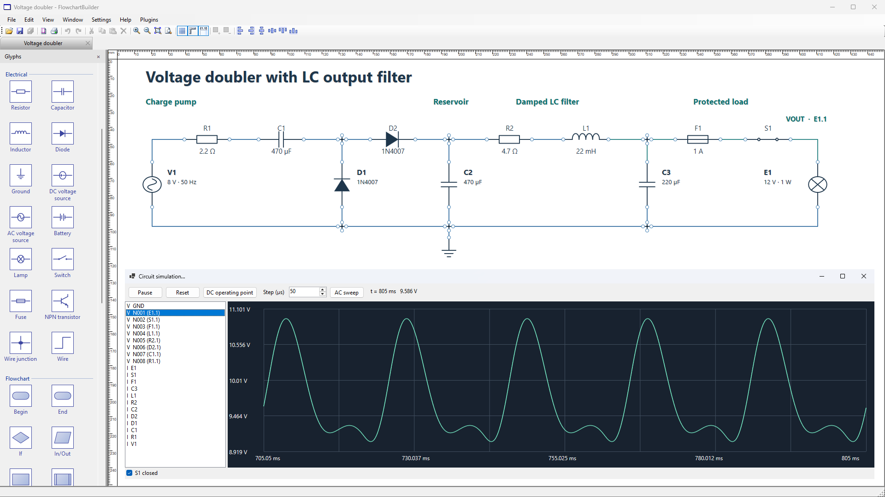

# FlowchartBuilder

A modular WinForms diagram editor with an infinite canvas. Start drawing immediately or press Ctrl+N for a new canvas. Drag with the middle mouse button to pan in any direction. Older paper-sized documents open on the same canvas.

I wrote it in 2008-2011 to explore plugin architecture and declarative metadata, back when MEF,
modern DI containers and `System.Text.Json` were not part of .NET yet. In 2026 the code was moved
to .NET 11, cleaned up and given a Direct2D renderer.



Drag the title of the glyph palette or the Properties window toward any edge of the work area.
Release over the highlighted area to dock, or away from the edges to float the window.
Drag the divider to resize a docked panel. Escape cancels a drag. The layout is restored on startup.

## Solution layout

`FlowchartBuilder.slnx` contains the editor, its libraries and plugins, and the FlowchartBuilder.Tests project.

### Framework

| Project | Role |
|---|---|
| `Makarov.Framework.Core` | Plugin loader, XML translations validated against an XML Schema, settings storages (registry, XML file, memory), image cache, window manager, serializer registry, critical error dialog |
| `Makarov.Framework.Serialization` | Culture-invariant string serializers for numbers, `bool`, `string`, `Color`, `Font` and `Version` |
| `Makarov.Framework.Graphics` | Direct2D renderer: a `Canvas` drawing API, the `CanvasControl` window, offscreen rendering to bitmaps, geometries and the geometric primitives (rhombus, star, trapezoid, rounded rectangle and others) |
| `Makarov.Framework.Components` | `TabsPanel`, the strip of document tabs |
| `Makarov.Framework.Instance` | Single instance: a named mutex plus a named pipe that passes the command line to the running copy |

### FlowchartBuilder

| Project | Role |
|---|---|
| `Makarov.FlowchartBuilder` | The application: documents, an infinite canvas, glyph base classes, editor commands, windows |
| `Makarov.FlowchartBuilder.API` | Attributes that describe glyphs: `[GlyphName]`, `[GlyphFamily]`, `[GlyphDefaultWidth]`, `[VisibleGlyph]`, `[CommandGlyph]`, `[ActiveProperty]` and others |
| `Makarov.FlowchartBuilder.Glyphs.Flowchart` | Begin, End, If, In/Out, Operation, Subroutine |
| `Makarov.FlowchartBuilder.Glyphs.Electrical` | Electrical components, wire junctions and orthogonal wires |
| `Makarov.FlowchartBuilder.Glyphs.Shapes` | 14 geometric shapes |
| `Makarov.FlowchartBuilder.Glyphs.Containers` | Group, Panel, Stack, Table |
| `Makarov.FlowchartBuilder.Glyphs.Simple` | Link tools: Arrow (curved), Broken Arrow (horizontal and vertical segments) and Link (straight, no arrowhead); embedded images and editable text |

Glyph libraries are plugins. On startup the application loads every assembly from the `Plugins`
folder next to the executable and puts every non-abstract glyph type into the palette, so a new DLL
in that folder adds new glyphs without rebuilding the application.

## How it works

**Rendering.** Everything on the sheet is drawn with Direct2D and DirectWrite through a small COM
interop layer in `Makarov.Framework.Graphics` (no third-party packages). The sheet view is a
hardware-accelerated `ID2D1HwndRenderTarget`; palette images, exported pictures and printed pages
are rendered into WIC bitmaps. Menus, tabs and dialogs are ordinary WinForms controls.

**Metadata in attributes.** A glyph describes itself with attributes and only draws its outline:

```csharp
[GlyphName("If")]
[GlyphDefaultWidth(30)]
[GlyphDefaultHeight(20)]
public sealed class IfGlyph : AbstractFlowchartGlyph
{
    protected override Primitive CreatePrimitive(int x, int y, int width, int height) => new Rhombus(x, y, width, height);
}
```

Properties marked with `[ActiveProperty]` are saved to the document, copied on paste and shown in
the Properties window; everything else stays out of the property grid. A glyph can also hide
properties that do not apply to it: blocks that cannot rotate (flowchart blocks, containers) hide
their angle.

**Documents.** A document is an XML file (`*.mfb`) with the sheet, the glyphs, the connectors and
the glyph groups. Glyphs are stored by class name, so documents keep loading as long as the class
names stay the same. Properties the current version does not know are skipped with a warning.

**Connectors.** Flowchart blocks show four link points. Drag from a link point to another block to
connect them with a curved arrow, or pick a link tool in the palette (Arrow, Broken Arrow, Link) and
drag from block to block. The route leaves and enters the blocks at right angles to their sides and
follows them when they move. To move an end, select the connector and drag the square handle at
that end to another port of the same block or to another block. Routing, arrowhead, color, width
and a caption shown in the middle of the line can be changed in the Properties window.

**Electrical schematics.** Pick a component in the Electrical palette. Drag from a terminal to another component to draw a wire, or select the Wire tool first. Use Wire junction for branches. Terminals follow a component when moved or rotated. Set its reference in Caption and its rating or part number in Component value. Switch contacts can be drawn open or closed.

**Undo.** Every change (mouse edits, menu commands, property edits) is one undo step. A step is a
snapshot of the document XML, so undo is exact for any operation; the last 100 steps are kept.

**Menus.** Menus and the toolbar are defined in `Data\MainMenu.xml` and `Data\SecondaryMenu.xml`.
Each item names a command class; commands are created on first use and shared by all items bound
to them.

**Settings.** Settings live in the registry under `HKCU\Software\MakarovFlowchartBuilder`. If the
registry is not available they go to `%AppData%\FlowchartBuilderSettings.xml`, and as a last resort
they are kept in memory. They can be exported to and imported from a `*.fbsettings` file.

**Translations.** English, Russian and Ukrainian dictionaries in `Translations\*.xml`. A new
language is used after a restart.

**Single instance.** Starting the application again (for example by opening a document from
Explorer) passes the file names to the running copy and brings it to the front.

## Building

You need Windows and Visual Studio 2026 or the .NET 11 SDK.

```
dotnet build FlowchartBuilder.slnx -c Release
```

The application is built into `Build\<Configuration>` and the glyph plugins into
`Build\<Configuration>\Plugins`. Menus, icons, images and translations are copied next to the
executable, so the build output runs as is.

`MakeFlowchartBuilder\Make.cmd` builds the Release configuration and, if Inno Setup is installed,
packs it into an installer in `MakeFlowchartBuilder\Output`. The installed application needs the
.NET 11 Desktop Runtime.

To move to a newer .NET, change `TargetFramework` in `Directory.Build.props`.

## Status

The editor opens an infinite canvas. Older paper formats load on that canvas. Document tabs,
keyboard shortcuts, pan and zoom, editable connector ends, grouping, locks, undo/redo and bitmap
export are implemented. Save As, Save All and close commands use the document's dirty state.
WindowsManager manages tool windows. Core owns editor services and the command and glyph
metadata caches. Direct2D render targets manage their drawing resources.

| Feature | How to use it |
|---|---|
| Image and Text | Pick a tool in the Common group. Image embeds the selected file in the document. The display bitmap is sampled to a maximum of 4096 pixels on its longer side. Edit a text block's caption, font and colour in Properties. |
| Placement and styling | Double-click a palette icon repeatedly to place blocks in free positions around the viewport centre. Drag a resize or rotation handle to snap the pointer to it. Blocks have shadows and palette icons have a uniform background. |
| Print and preview | File → Page Setup sets the paper and margins. Print Preview and Print tile the content at actual size, from left to right and then top to bottom. |
| Clipboard | Copy or cut selected blocks, then paste into the same or another document. Groups and connections between copied blocks travel with them. Other applications can read the selection as XML text. Repeated pastes are offset by 5 mm. |
| Languages and units | On first use the editor selects English, Russian or Ukrainian from the Windows UI culture, and millimetres or inches from regional settings. Explicit preferences take precedence. |
| About | Help → About shows the editor version, copyright and full MIT license. |

Run the Windows test suite with `dotnet test FlowchartBuilder.slnx -c Release`. It checks history,
XML settings and clipboard fragments, translations, connector routing, Direct2D bitmap drawing
and tiled pagination.

## License

Copyright © 2008-2026 Mykhailo Makarov. Distributed under the [MIT License](LICENSE).

## Support

If you found this project interesting or useful, you can support my work:

[](https://github.com/sponsors/makarov-mm)
